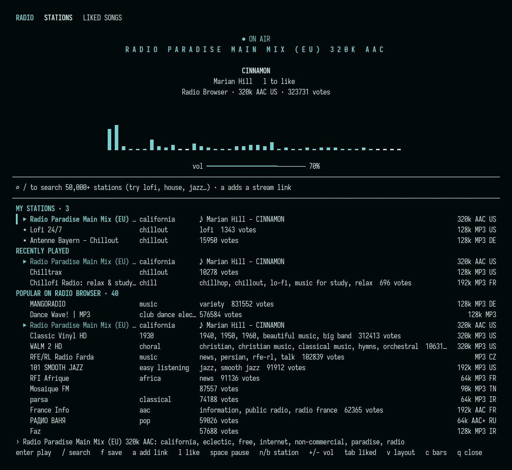
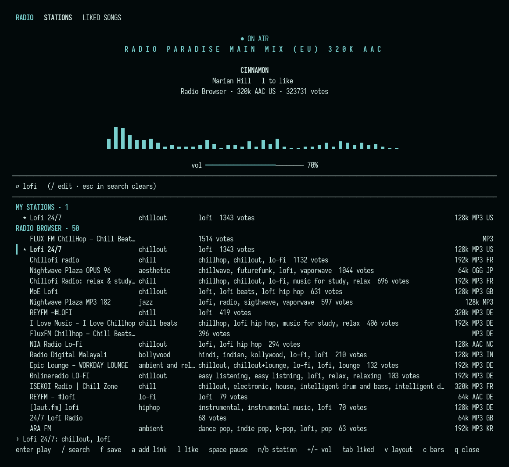
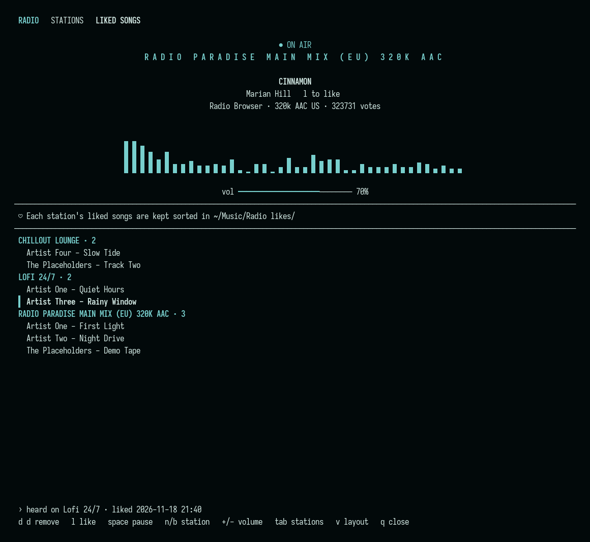
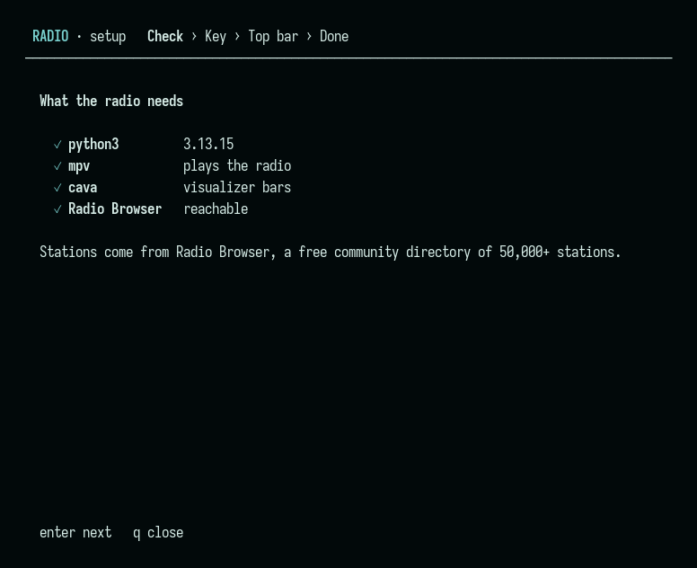
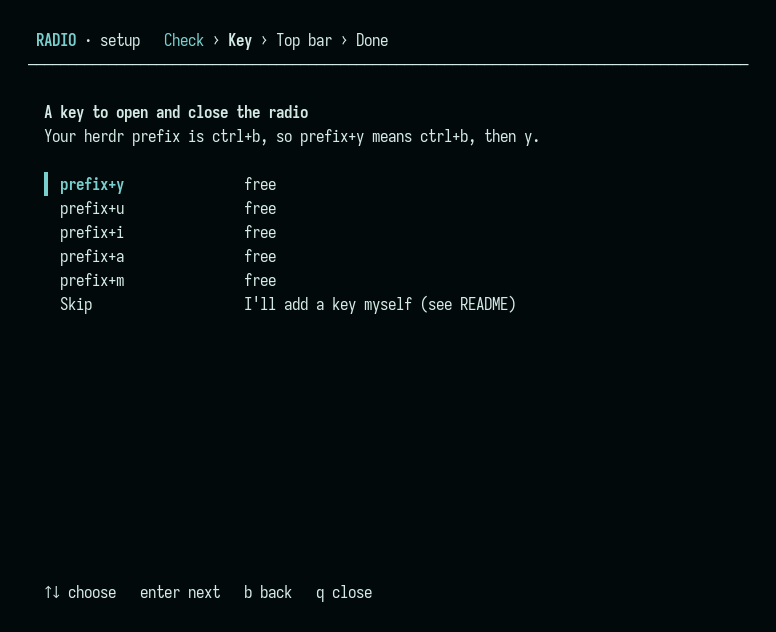
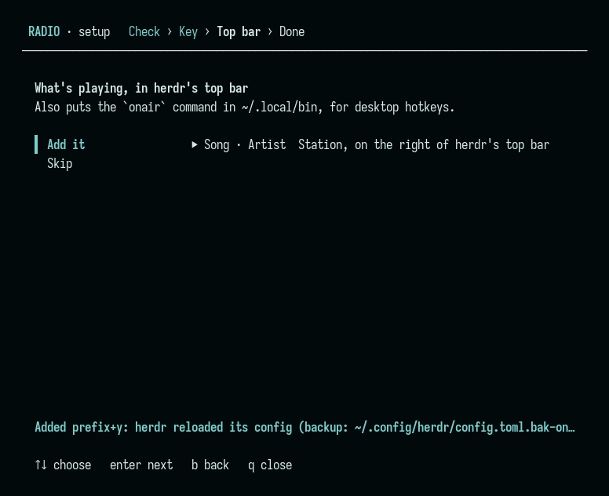
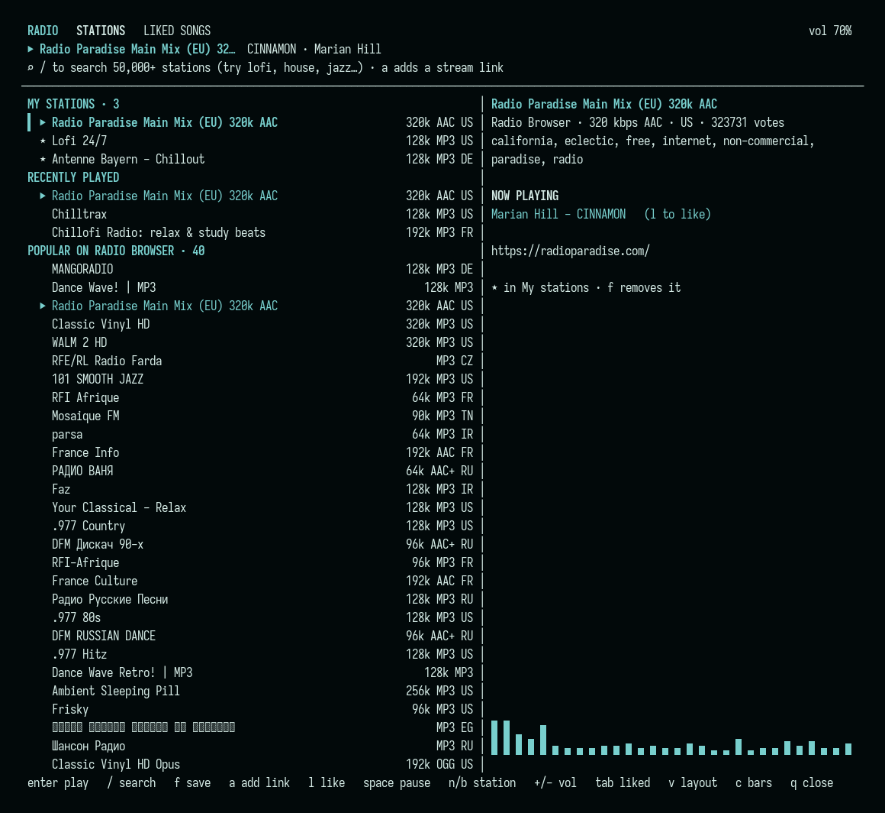
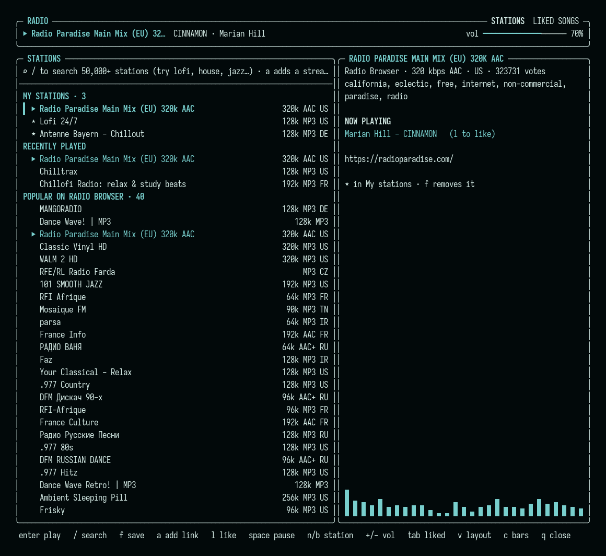
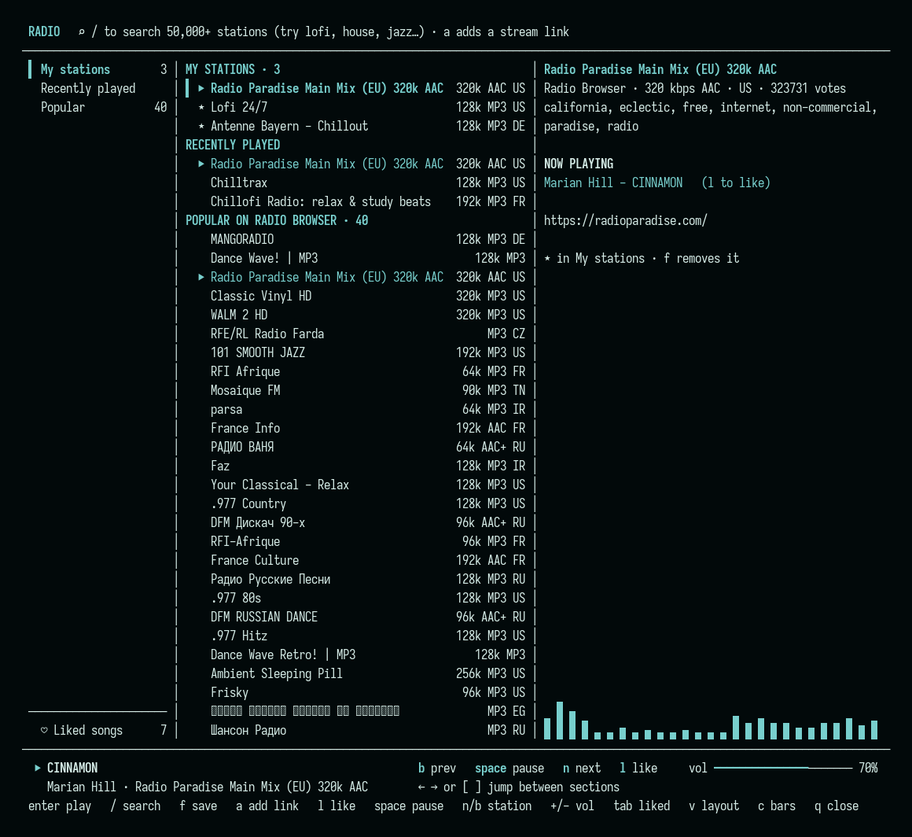
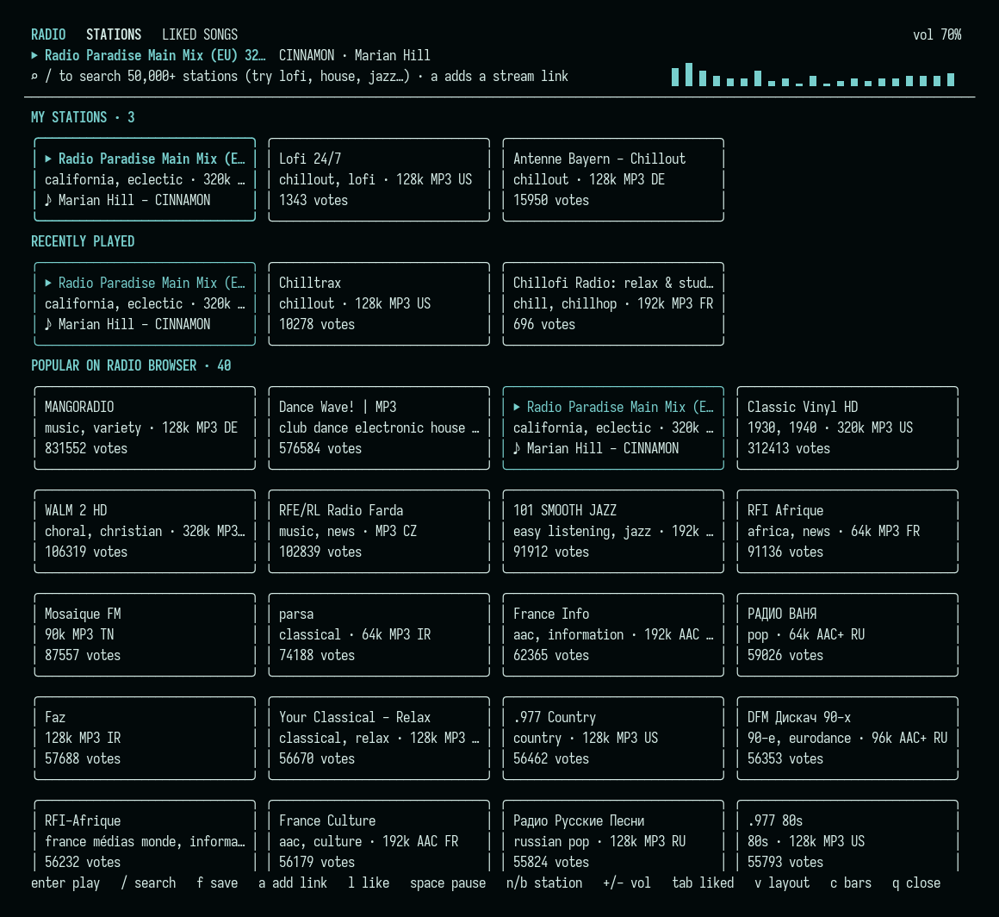

# herdr-onair

Internet radio in a [herdr](https://herdr.dev) popup. Search 50,000+ stations, play one, close the
popup and keep listening. Like the songs you hear and each station keeps its own sorted list.



<p>
  
  
</p>

```
▶ CINNAMON · Marian Hill ♥  📻 Radio Paradise      ← herdr's top bar (optional)
```

- **50,000+ stations** from [Radio Browser](https://www.radio-browser.info), a free community
  directory: search by name or genre (`lofi`, `house`, `jazz`, `ambient`…), most-voted first.
- **My stations:** press `f` to keep a station, or `a` to add any stream link you have.
- **Keeps playing** with the popup closed. Playback runs in [mpv](https://mpv.io) in the background.
- **Liked songs per station.** Press `l` and the song playing now goes into a plain text list for
  that station, sorted by artist, so you have a ready-made list if you ever want to buy the music.
- **Five layouts** (`v` switches) and an audio **visualizer** when
  [cava](https://github.com/karlstav/cava) is installed.
- **Works with your theme.** Colours are terminal colour names, so they follow your terminal theme.
- **Optional extras:** a now-playing line in herdr's top bar, and play/pause/next/like/volume keys
  for your desktop.

Made for herdr's terminal app (TUI) on Linux and macOS. Needs python3 (standard library only) and
mpv; cava is optional.

## Install

1. Install mpv (and cava if you want the visualizer):

   | System | Command |
   | --- | --- |
   | Arch / Omarchy | `sudo pacman -S mpv cava` |
   | Debian / Ubuntu | `sudo apt install mpv cava python3` |
   | Fedora | `sudo dnf install mpv cava python3` |
   | macOS | `brew install mpv cava` (python3 comes with the Xcode command line tools) |

2. Install the plugin:

   ```sh
   herdr plugin install c-a-l-i/herdr-onair
   ```

   or find it in the plugin manager's marketplace. herdr shows you exactly what the plugin will run
   before anything does.

3. Run setup: open the plugin manager, pick **herdr-onair** and run **Radio: setup**, or run

   ```sh
   herdr plugin action invoke setup --plugin herdr-onair
   ```

Setup checks what's installed (and shows the install command for anything missing), adds a herdr
key for the radio, and can add the now-playing line to herdr's top bar. It backs up your herdr config
before changing it and checks the change with herdr's own config reload; if herdr objects, the
backup goes back. It also opens by itself the first time you open the radio.

<p>
  
  
  
</p>

<details>
<summary>Setting it up by hand instead</summary>

Add a key to `~/.config/herdr/config.toml` (any free key works) and run `herdr server reload-config`:

```toml
[[keys.command]]
key = "prefix+y"
type = "plugin_action"
command = "herdr-onair.toggle"
```

For the top bar, run `herdr plugin action invoke install-commands --plugin herdr-onair` once (it
puts `onair` and `onair-now-playing` in `~/.local/bin`; they keep working after plugin updates),
then add this to the `[ui]` section, with your own home folder in the path:

```toml
tab_bar_right = [
  { type = "command", command = "/home/you/.local/bin/onair-now-playing", interval_seconds = 1, timeout_seconds = 1 },
]
```

The icons need a [Nerd Font](https://www.nerdfonts.com); `bar_icons = plain` (see Settings) uses
plain characters.
</details>

## Using it

| Key | Does |
| --- | --- |
| `/` | search (enter when done, esc clears) |
| `↑` `↓` / `j` `k` | move |
| `enter` | play the highlighted station |
| `space` | pause / resume |
| `l` | like the song playing now |
| `f` | save the highlighted station to My stations (again to remove it) |
| `a` | add a stream link to My stations |
| `n` / `b` | next / previous station in the list you played from |
| `+` / `-` | volume |
| `tab` | switch between stations and liked songs |
| `d` `d` | remove a liked song (in liked songs) |
| `[` / `]` | jump to the previous / next section |
| `v` | next layout |
| `c` | visualizer on / off |
| `x` | stop |
| `q` / `esc` | close the popup (the radio keeps playing) |

Before you search, the list shows My stations, what you played recently and the most popular
stations on Radio Browser. Each station shows its stream quality: `192k MP3 FR` is 192 kbps MP3
from France (higher sounds better; 128k is decent, 192k and up is high quality).

## My stations

Press `f` on any station to keep it at the top of the list, or `a` to add a stream link that isn't
in Radio Browser: a direct stream, or a `.pls` / `.m3u` playlist link. From a terminal:

```sh
onair add https://example.com/radio.pls "My favourite station"
onair mine
onair remove "My favourite station"
```

Only add links you're allowed to listen to. Some stations offer links for personal listening in
media players like this one; others don't allow third-party players at all.

## Layouts

Press `v` in the popup to switch; it remembers your pick (`layout` in Settings sets it too).

| | |
| --- | --- |
| **Spotlight** (default, top of this page) | the station on air large at the top with the visualizer, then one wide list with each station's genre, tags and votes |
| **Classic** | the station list and its details side by side |
| **Framed** | the same in rounded panels, with now playing and a volume bar on top |
| **Sidebar** | sections on the left (My stations, recently played, popular, liked songs), list, details, and a player bar at the bottom |
| **Cards** | every station as a tile with its genre and quality |

<p>
  
  
</p>
<p>
  
  
</p>

Framed and Sidebar fall back to Classic in a narrow popup; Spotlight tightens its top part.

## Visualizer

With [cava](https://github.com/karlstav/cava) installed, the popup shows live audio bars (in
Spotlight under what's playing, in the other layouts at the edge of the details). `c` turns them
off and on; `visualizer = off` in Settings keeps them off. cava listens to everything your computer
plays, so other sounds move the bars too. On macOS, cava needs a loopback audio device (such as
BlackHole) to hear system audio.

## Liked songs

Liked songs are saved in `~/Music/Radio likes/`, one file per station:

```
# Radio Paradise Main Mix (EU) 320k AAC: 3 liked songs, sorted by artist

Artist One - First Light  [Morning Sessions]
Artist Two - Night Drive
The Placeholders - Demo Tape  [Demo Tape]
```

The files are rewritten, still sorted, whenever you like or remove a song. Everything (station,
source, time) is also kept in `.likes.json` in the same folder. Only stations that send song titles
can have their songs liked; some send just their own name or a slogan.

## Keys outside the popup

Every control is also a herdr action (bind it with `type = "plugin_action"`) and an `onair` command
(after `install-commands`), for desktop hotkeys:

| Action | Command |
| --- | --- |
| `herdr-onair.toggle` | `onair toggle` |
| `herdr-onair.play-pause` | `onair play-pause` |
| `herdr-onair.next` / `.previous` | `onair next` / `onair prev` |
| `herdr-onair.like` | `onair like` |
| `herdr-onair.volume-up` / `.volume-down` | `onair up` / `onair down` |
| `herdr-onair.stop` | `onair stop` |
| `herdr-onair.setup` | `onair setup` |

Hyprland example (`hyprland.conf`):

```
bind = ALT, P, exec, ~/.local/bin/onair play-pause
bind = ALT, N, exec, ~/.local/bin/onair next
bind = ALT, L, exec, ~/.local/bin/onair like
binde = ALT, equal, exec, ~/.local/bin/onair up
binde = ALT, minus, exec, ~/.local/bin/onair down
```

Sway / i3: `bindsym Mod1+p exec ~/.local/bin/onair play-pause`. macOS with skhd:
`alt - p : ~/.local/bin/onair play-pause`. `onair play lofi` plays the best match for a search and
`onair search house` lists matches.

## Settings

All optional. Copy [`settings.conf.example`](settings.conf.example) to `settings.conf` in the
folder `herdr plugin config-dir herdr-onair` prints (setup creates it for you):

| Setting | Default | |
| --- | --- | --- |
| `accent` | `cyan` | highlight colour: a terminal colour name, `bright-<name>`, or `none` |
| `likes_dir` | `~/Music/Radio likes` | where the liked-song lists go |
| `min_bitrate` | `64` | hide streams below this many kbps (`0` shows all) |
| `bar_icons` | `nerd` | top-bar icons: `nerd` or `plain` |
| `volume_step` | `5` | volume change per press, in % |
| `layout` | `spotlight` | `spotlight`, `classic`, `framed`, `sidebar` or `cards` |
| `visualizer` | `auto` | `auto` shows the bars when cava is installed; `off` hides them |
| `popup_width` / `popup_height` | `72%` / `80%` | the popup's size: a share of herdr's window or cells |

## Troubleshooting

- **Nothing plays:** run setup again (it checks mpv and your connection), or run
  `onair play lofi` in a terminal to see the error.
- **A station won't play:** Radio Browser lists stations run by thousands of different people and
  some go offline; the popup says so. Try the next one (`n`).
- **No song title / can't like:** that station doesn't send titles.
- **The popup is cramped (or too big):** change `popup_width` / `popup_height`.
- **No visualizer:** install cava, then press `c` in the popup.

## About the stations

Stations come from Radio Browser, which asks apps to identify themselves and to report plays: this
plugin sends `herdr-onair/<version>` as its name and a "click" when you play one of its stations,
which is how the directory ranks stations. [SomaFM](https://somafm.com) is left out on purpose: its
[terms](https://somafm.com/contact/tos.html) don't allow third-party apps to use its streams,
station list or song information. Listen to it on its own website or official apps.

## Privacy

herdr-onair talks to Radio Browser (your search words, the popular list, and a click when you play
one of its stations) and to the station you play. It sends nothing else and has no accounts or
tracking. Liked songs and My stations stay on your computer.

## How it works

- `bin/onair` is the command line, `bin/now-playing` the top-bar line, `onair/app.py` the popup and
  `onair/setup.py` the setup screen (both curses), `onair/core.py` everything else.
- Playback is one mpv process, started when you first play something (`--no-config --idle`, with a
  JSON control socket in herdr's plugin state folder). It keeps running after the popup closes;
  `onair stop` ends it.
- Radio Browser is searched by station name and tag, most-voted first, leaving out broken streams
  and very low bitrates; its servers are found through DNS, as that project asks.

## Similar plugins

- [wave-tui](https://github.com/takemo101/wave-tui): a polished radio app with a visualizer
  (Rust; Radio Browser search, favourites).
- [herdr-radio](https://github.com/vrwolf1004/herdr-radio): Radio Browser stations with the current
  station in herdr's sidebar.
- [musicforprogramming](https://github.com/pivoshenko/musicforprogramming): musicforprogramming.net
  mixes.

## License

MIT. Forks, changes and pull requests welcome.
